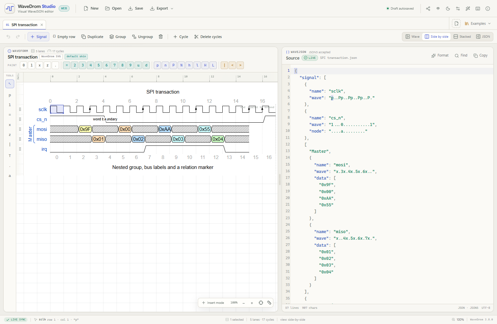
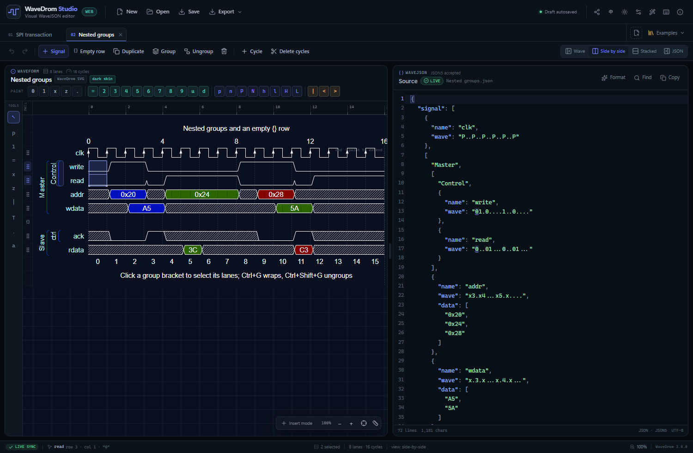
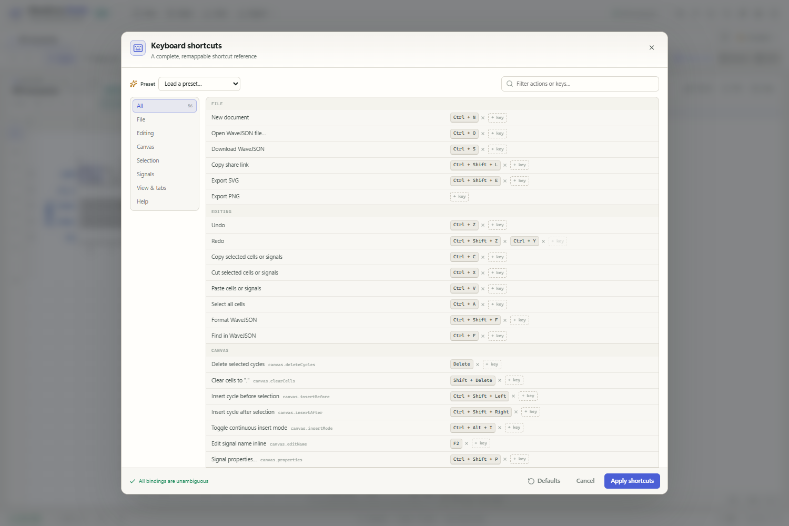
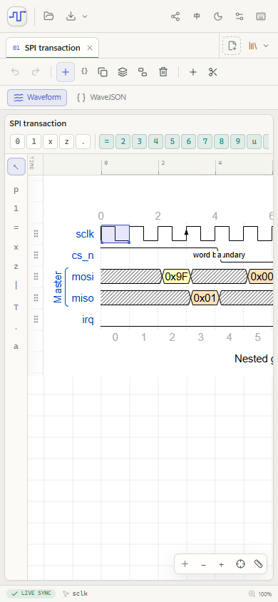
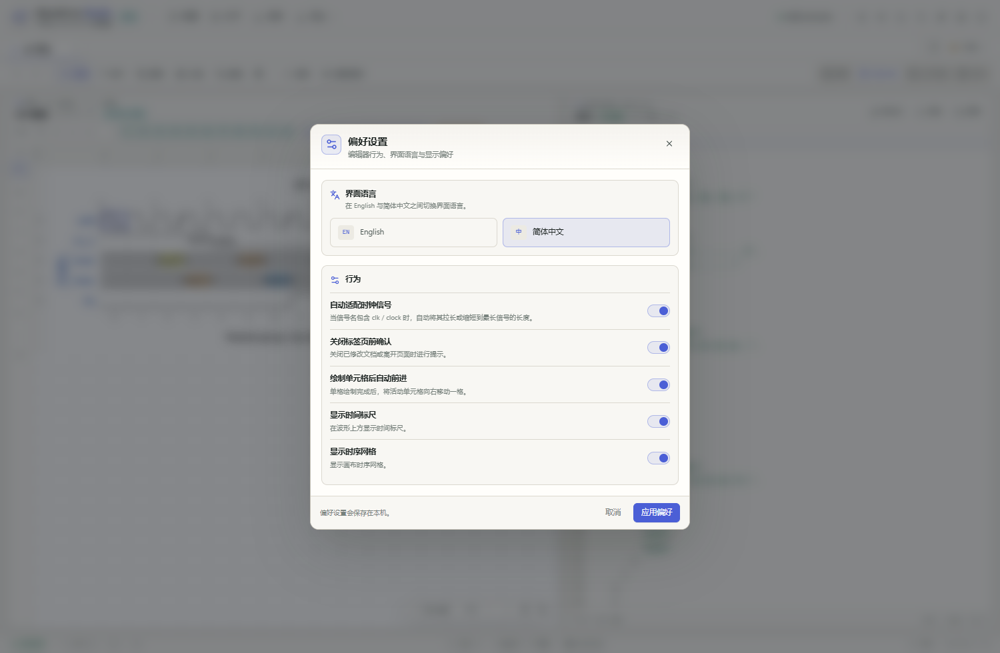

# WaveDrom Studio

**A browser-native visual editor for WaveJSON, rendered by the official WaveDrom engine.**

[](https://github.com/Nymph-K/WaveDromStudio/releases/latest)
[](LICENSE)
[](https://github.com/wavedrom/wavedrom)

WaveDrom Studio puts a desktop-class timing-diagram editor in a static web page. The waveform is produced by
[`wavedrom`](https://github.com/wavedrom/wavedrom)'s own SVG renderer; an independent interaction layer paints a cell grid,
selection, label editors and group handles over the official geometry. The right-hand editor accepts strict JSON **and**
JSON5, and both views stay in sync in real time.

> 中文简介：基于官方 `wavedrom` 渲染引擎的 Web 版图形化 WaveJSON 编辑器，支持画布单元格绘制、左侧编辑工具、内联信号名 /
> 总线标签编辑、拖拽排序、嵌套分组、周期增删、自适应时钟、多标签页、撤销/重做、中英文界面、关闭保存提示、剪贴板、URL 分享、
> 本地草稿、亮/暗主题以及 SVG/PNG 导出。所有逻辑均在浏览器内运行，无后端依赖。
> 中文文档：[README.zh-CN.md](README.zh-CN.md)。



## One-click launch

The fastest way to start is the **[latest release](https://github.com/Nymph-K/WaveDromStudio/releases/latest)**:

- **`WaveDromStudio.html`** — a fully self-contained single file. Download it and open it in a browser. No install, no
  server, no network access required.
- **`WaveDromStudio-one-click.zip`** — extract it and double-click `START.cmd` on Windows, or open
  `WaveDromStudio.html` directly on any OS.
- **`wavedrom-studio-1.0.1-static.zip`** — the deployable static build for a web server.

The application itself is also published as source in this repository.

## Highlights

- **Official renderer, nothing rewritten.** Every redraw calls `WaveDrom.renderWaveElement()` from the `wavedrom`
  package with the official skin definitions. Exported SVG uses exactly that output.
- **True two-way editing.** Paint cells on the canvas and `wave` strings update in the editor immediately; type JSON5 and
  the canvas rerenders after a 170 ms debounce. Invalid JSON keeps the last valid diagram and reports line and column.
- **Desktop-grade canvas.** Rectangular selection (including a continuous blank-cycle runway with auto-scroll), batch
  painting, single-cell auto-advance, inline signal/bus-label editing with Enter / Tab navigation, drag-to-reorder with an
  insertion line, and full keyboard navigation.
- **Left editing-tool rail.** Select, clock (`p → P → n → N`), signal (single-click 0/1 toggle), bus, unknown, high-Z, gap,
  text, clear and node tools — the interaction model of the desktop WaveDromGen reference.
- **Real signal structure.** Named and nested groups, group selection by bracket, group/un-group, duplicate,
  cut/copy/paste, empty `{}` spacer rows, and signal properties (`period`, `phase`, `data`, `node`, …) that round-trip.
- **Empty labels are editable.** Blank bus `data` slots show a small `+` target and participate in `Tab` navigation; no
  more dead-end empty labels.
- **Adaptive clocks.** Lanes whose name contains `clk` or `clock` automatically extend or shrink to the longest
  non-clock signal. The behaviour can be enabled/disabled in **Preferences**.
- **Chinese + English UI.** Switch the interface language from the header (`中` / `EN`) or **Preferences**. The choice is
  persisted; dialogs, shortcut manager, tooltips and tool modes are translated.
- **Unsaved-change protection.** Closing a modified document asks whether to save the WaveJSON file, and closing the
  browser tab triggers the browser's leave confirmation while any document is dirty.
- **Multiple documents.** Every tab keeps source, undo history, selection, zoom and scroll position. Six bundled examples.
- **Web extras.** `localStorage` draft autosave, compressed share links, system-clipboard blocks, resizable split view,
  responsive single-column layout, light/dark themes, time ruler and high-resolution PNG export.
- **No backend.** `pnpm build` writes a self-contained static site to `dist/`; `pnpm build:single` creates the one-file
  launchable HTML.

Verified flows and measurements are in [docs/VERIFICATION.md](docs/VERIFICATION.md).

## Screenshots

| Light theme | Dark theme + nested groups |
| --- | --- |
|  |  |

| Shortcut manager | Responsive single-column mode |
| --- | --- |
|  |  |

| Chinese interface | |
| --- | --- |
|  | |

## Quick start

Requirements: Node.js 22.12+ and pnpm (npm also works).

```bash
pnpm install
pnpm dev        # or: pnpm start  (opens the browser)
```

Open the URL printed by Vite (usually `http://localhost:5173`). Production/static and one-file builds:

```bash
pnpm build         # static site in dist/
pnpm build:single  # self-contained HTML in dist-single/index.html
pnpm preview
```

The static build can be uploaded as-is to GitHub Pages, Netlify, Vercel, Cloudflare Pages, S3 or any other static host.
Vite uses a relative `base`, so sub-path deployments work without rebuilding.

### Tests

```bash
pnpm test          # Vitest: model, clock fitting, source locator, shortcuts
pnpm check         # TypeScript, Vitest and Oxlint
```

## Using the editor

### Editing tools

The vertical rail on the left of the waveform provides classic single-click modes:

| Tool | Single click |
| --- | --- |
| **Select** (`↖`) | Select a cell / start a rectangular drag |
| **Clock** (`p`) | Paint a clock; repeated clicks cycle `p → P → n → N → p` |
| **Signal** (`1`) | Toggle a level signal between `0` and `1` |
| **Bus** (`=`) | Toggle a data bus cell |
| **Unknown** (`x`) | Toggle an unknown state |
| **High-Z** (`z`) | Toggle high impedance |
| **Gap** (`\|`) | Toggle a gap marker |
| **Text** (`T`) | Edit the clicked signal name or data label inline |
| **Clear** (`.`) | Clear the clicked cell to `.` |
| **Node** (`a`) | Edit the node marker (unique marker validation) |

Dragging with a painting tool fills the touched cells. Choosing a tool exits insert mode; click **Select** to return to
normal keyboard painting.

### Canvas

| Gesture | Action |
| --- | --- |
| Click a cell | Select one cell; type a WaveDrom character to paint it |
| Drag across cells | Rectangular multi-cell selection |
| Drag into the empty area to the right | Keep auto-scrolling and extend the selection; painting extends the lanes |
| Double-click a signal name | Rename inline; `Enter` goes to the next name |
| Double-click a bus label / `+` placeholder | Edit a `data` value; `Tab` goes to the next label, including empty ones |
| Drag a row's gutter grip | Reorder a signal (or drop it into a group) |
| Click a group bracket | Select every lane in that group |
| Middle-click a cell | Toggle continuous insert mode |
| Middle-drag across rows | Start a multi-row insert mode; the INS caret appears on every selected row |
| Right-click | Editing context menu for cells, signals and groups |
| `Ctrl+Enter` | Add a signal below the selection and immediately enter inline name editing |
| Drag the divider | Resize the waveform/JSON split |

The character palette in the waveform header is a clickable alternative to typing. All WaveDrom wave characters are
supported: `0 1 x z = u d p P n N l L h H 2–9 | . < >`.

### WaveJSON panel

The editor accepts JSON5 comments, single-quoted strings, unquoted keys and trailing commas. Valid input renders after a
short debounce. If parsing fails, the previous diagram stays visible, the tab shows an error dot, and the banner reports
the line and column. Selecting canvas cells highlights the corresponding characters in every selected lane's `wave`
string and scrolls the editor to it.

### Signals and groups

- **Group:** select rows (gutter, cells or Ctrl-click row grips) and press `Ctrl+G`, or use **Group** in the command bar /
  context menu. Every selected row is included, and the group-name field opens focused and selected for immediate typing.
- **Ungroup:** select a complete group and press `Ctrl+Shift+G`.
- **Copy/move:** `Ctrl+C` / `Ctrl+V` or the context menu copies signal blocks, including full nested groups; `Alt+↑/↓`
  moves selected rows and groups within their parent.
- **Empty rows:** the `{}` button inserts a spacer lane. Inserted signals use the longest clock lane's length.
- **Adaptive clocks:** enable **Preferences → Auto-fit clock lanes** to stretch/shrink clocks to the longest non-clock
  lane. **Ctrl+Shift+9** (default binding) also runs a one-shot fit.
- **Properties:** right-click a lane → **Signal properties…** to edit its name, wave, node markers, data labels, `period`
  and `phase`.

### Diagram settings and preferences

The wand icon opens **Diagram settings**: skin (`default`, `lowkey`, `narrow`, `dark`), `hscale`, head/foot text,
tick/tock/every values. JSONML head/foot text is shown as JSON and preserved when unchanged. The dark interface
automatically overrides the skin with WaveDrom's official `dark` skin.

The gear icon opens **Preferences**: interface language, adaptive clocks, close confirmation, auto-advance, ruler and grid.

### Documents, persistence and closing

- Tabs preserve source, selection, zoom and scroll position. `Ctrl+Tab` / `Ctrl+Shift+Tab` cycles documents.
- Drafts are auto-saved to `localStorage` and restored after reload. The tab dot and header show unsaved changes.
- **Save** downloads the editable `.json` source and marks the document clean.
- Closing a dirty tab opens a three-way prompt: **Save and close**, **Discard and close**, **Keep editing**. Closing the
  browser tab while any document is dirty triggers the browser's leave confirmation.
- **Share** copies an editable link containing LZ-compressed WaveJSON in the `?doc=` query string.
- **Export** offers SVG (same content as the canvas), 3× PNG and a downloadable WaveJSON file.

## Shortcuts

A complete table is in [docs/SHORTCUTS.md](docs/SHORTCUTS.md) and in the app under **F1**. All 56 actions are remappable
with conflict detection, two optional bindings per action, and three presets (Studio, WaveDromGen classic, Minimal).

Some defaults:

| Action | Default |
| --- | --- |
| Paint / navigate | Character keys and arrow keys |
| Add signal below selection + edit name | `Ctrl+Enter` |
| Undo / redo | `Ctrl+Z` / `Ctrl+Shift+Z` |
| Delete cycles / clear to `.` | `Delete` / `Shift+Delete` |
| Insert cycle before / after | `Ctrl+Shift+←` / `Ctrl+Shift+→` |
| Group / ungroup | `Ctrl+G` / `Ctrl+Shift+G` |
| Duplicate signal | `Ctrl+D` |
| Delete signal | `Ctrl+Delete` |
| Fit clocks to longest lane | `Ctrl+Shift+9` |
| Zoom reset / in / out | `Ctrl+0` / `Ctrl+=` / `Ctrl+-` |
| Waveform only / JSON only | `Ctrl+1` / `Ctrl+2` |
| Side-by-side / stacked | `Ctrl+3` / `Ctrl+4` |
| Toggle theme | `Ctrl+Shift+T` |
| Shortcut manager | `F1` |

## Bundled examples

| File | Scene |
| --- | --- |
| [`examples/spi-transaction.json`](examples/spi-transaction.json) | SPI clock and chip select with a nested master group and bus labels |
| [`examples/bus-write.json`](examples/bus-write.json) | AXI-style valid/ready handshake and a 32-bit data bus |
| [`examples/nested-groups.json`](examples/nested-groups.json) | Nested `Master`/`Control` and `Slave`/`ctrl` groups plus an empty `{}` row |
| [`examples/edges-and-nodes.json`](examples/edges-and-nodes.json) | Node markers, curved edges, orthogonal sharp lines and JSONML head text |
| [`examples/ddr-read.json`](examples/ddr-read.json) | The WaveDrom tutorial DDR read with `period` and `phase` |
| [`examples/handshake.json`](examples/handshake.json) | Minimal request/acknowledge handshake |

Every example opens from the **Examples** menu and is rendered without preprocessing by WaveDrom.

## Architecture

```text
src/
  renderer/wavedromEngine.ts   Official WaveDrom adapter, SVG/PNG serialization, geometry extraction
  model/waveModel.ts           WaveJSON tree model, groups, cycles, node markers, validation and serialization
  model/clockFit.ts            Adaptive clock fitting + source-preserving wave literal patches
  model/sourceLocator.ts       JSON5 wave-token scanner for editor highlighting
  state/appStore.ts            Documents, tabs, selections, undo history, dirty state, persistence, settings
  components/WaveCanvas.tsx    Interaction layer over the stateless SVG (tools, hit testing, overlays, inline editors)
  components/JsonEditor.tsx    CodeMirror 6 WaveJSON editor, error markers and wave fragment highlights
  components/dialogs/...       Settings, preferences, signal properties, group, shortcuts and close prompts
  i18n.ts                      English/Chinese UI dictionary and automatic document-name localization
  examples/index.ts            Bundled example sources
```

The rendering boundary is intentionally narrow:

```text
 WaveJSON state ──renderWaveDrom()──▶ official SVG + measured geometry
      ▲                                  │
      │                                  ▼
 JSON5 editor ◀── source ── App store ◀── cell / tool / label / group interactions
```

- **Render layer** has no React state and no editing logic. It deep-clones the source, calls WaveDrom's renderer, and
  returns a detached SVG plus measured lane geometry.
- **Interaction layer** keeps transient hover/drag/tool state, maps pointer positions to logical `(row, character)` cells,
  accounts for per-lane `period` and `phase`, and draws selection overlays. It never redraws waveform paths.
- **Model layer** is pure WaveJSON tree manipulation; it preserves unknown fields and round-trips nested groups.
- **Serialization layer** validates and pretty-prints JSON, parses strict JSON/JSON5 and records source offsets for the
  editor overlay.

More detail: [docs/ARCHITECTURE.md](docs/ARCHITECTURE.md).

## Deployment

No server-side runtime or environment variables are involved.

```bash
pnpm build
# deploy dist/
```

- **Vercel:** import the repository; the included config uses `pnpm build` and `dist`.
- **Netlify:** the included `netlify.toml` uses `pnpm build` and publishes `dist`.
- **GitHub Pages:** `.github/workflows/deploy.yml` builds and publishes `dist` using GitHub's Pages actions.
- **Any static host:** copy the contents of `dist/`.

The app uses relative asset URLs, so project-page sub-paths (e.g. `/wavedrom-studio/`) work without rebuilding.

## Notes and limitations

- Canvas edits canonicalize the document as pretty-printed JSON (canvas edits replace JSON5 formatting); undo restores
  the previous text, including comments. Adaptive clock fitting applies only to the affected clock wave literals and
  preserves comments and formatting.
- `localStorage` is per browser/origin. There is no account sync.
- Sharing encodes one active document at a time. Share links open into a new tab and the current URL is cleaned afterwards.
- A single-file `file://` launch keeps drafts in that file's storage origin; for share links and deployment, use the static
  build behind an HTTP origin.
- WaveDrom's `<` and `>` sub-cycle markers are accepted as paintable characters. They retain WaveDrom's own time-axis
  semantics rather than behaving like ordinary one-cycle cells.
- Very large diagrams are supported, but the editor is tuned for interactive timing diagrams rather than multi-thousand-lane
  renders.
- The Vite/Rolldown build may mention direct `eval` in WaveDrom's unused `eva.js` helper and a large-chunk warning. The app
  does not call that helper or evaluate user input; the note comes from the upstream engine bundle.

## Credits and license

- Rendering: [WaveDrom](https://github.com/wavedrom/wavedrom), MIT, by Aliaksei Chapyzhenka and contributors.
- Interaction model and visual reference: [Nymph-K/wavedromgen](https://github.com/Nymph-K/wavedromgen), the desktop
  WaveDrom editor that inspired the tool rail, signal-fitting and canvas behaviours.
- Interaction/editor: WaveDrom Studio contributors, MIT.
- Built with React, Vite, Zustand, CodeMirror 6, JSON5, lucide-react, lz-string and `vite-plugin-singlefile`. See
  [THIRD_PARTY_NOTICES.md](THIRD_PARTY_NOTICES.md).

WaveDrom Studio is an independent companion editor and is not an official WaveDrom project.
