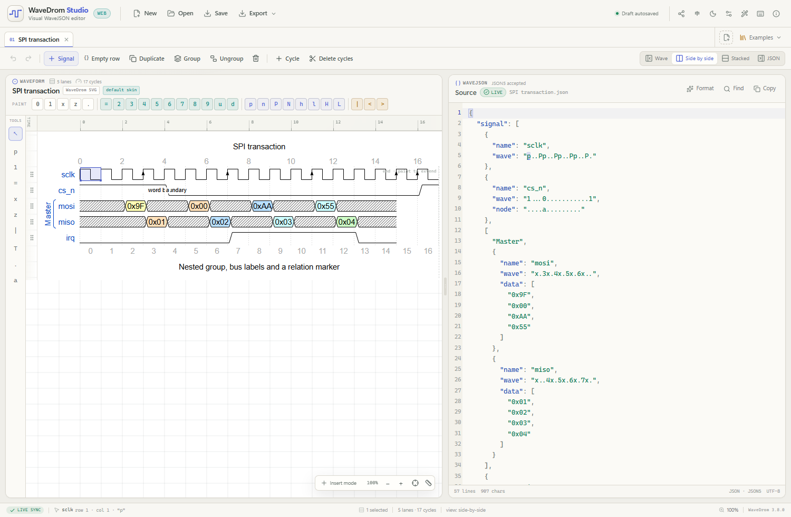

# WaveDrom Studio 中文说明

**基于官方 WaveDrom 渲染引擎的 Web 图形化 WaveJSON 时序图编辑器。**

左侧波形由 [`wavedrom`](https://github.com/wavedrom/wavedrom) 官方 JS 引擎直接生成 SVG；本编辑器只在其上叠加交互层
（单元格选择、绘制、左侧工具、内联标签、分组、拖拽等），没有重写任何波形渲染逻辑。右侧接受严格 JSON 与 JSON5
（注释、单引号、无引号键、尾随逗号），两边实时双向同步。



## 一键启动

从 [最新 Release](https://github.com/Nymph-K/WaveDromStudio/releases/latest) 下载：

- `WaveDromStudio.html`：单文件版，双击用浏览器打开即可，无需安装、无需联网、无后端。
- `WaveDromStudio-one-click.zip`：解压后双击 `START.cmd`（Windows），或直接打开 HTML。
- `wavedrom-studio-1.0.0-static.zip`：可部署到服务器/静态托管的版本。

## 主要能力

- **左侧编辑工具栏**：选择、时钟（单击循环 `p → P → n → N`）、电平信号（单击翻转 0/1）、总线、未知、高阻、
  间隔、文本、清除、节点；在对应模式下单击波形即可编辑。拖动绘制工具可以连续填充。
- **画布编辑**：点击/框选单元格，键入 `0 1 x z = u d p P n N l L h H 2–9 | . < >` 批量绘制；单格绘制后自动前进。
  空白周期可一直向右框选，画布会持续自动滚动并扩展。
- **内联标签**：双击信号名或总线数据标签编辑；`Enter` 跳到下一信号名，`Tab` 跳到下一数据标签。空数据标签会显示
  `+` 占位符，也可以被 `Tab` 选中和双击编辑。
- **自适应时钟**：名称包含 `clk` / `clock` 的信号会自动伸展/缩短到最长非时钟信号；可在 **偏好设置** 中关闭。
- **结构编辑**：新增、插入、复制、删除信号；`Ctrl+Enter` 新增信号并自动进入名称编辑；空行 `{}`；gutter 拖拽排序；
  右键菜单编辑 `period` / `phase` / `data` / `node`。
- **命名与嵌套分组**：多选信号后 `Ctrl+G` 分组；修复了只包含最后一个信号的问题，现在会包含全部选中行。
- **循环编辑**：删除选中循环、清除为 `.`、在选区前后插入循环，以及连续插入模式。
- **多行插入**：鼠标中键拖动可进入多行插入模式，所有选中行都会显示 INS 光标。
- **中英文界面**：页头 `中` / `EN` 按钮或偏好设置可切换 English / 简体中文，语言会被记住。
- **保存提示**：关闭有未保存修改的标签页会询问保存；关闭浏览器标签页时会触发浏览器离开确认。
- **图表设置**：官方 skin、`hscale`、head/foot 文本、tick/tock/every；暗色界面自动使用官方 `dark` skin。
- **多文档**：标签页各自保留源码、选区、撤销栈、缩放和滚动位置；提供 6 个内置示例。
- **统一撤销/重做**：画布操作与 JSON 编辑共用 `Ctrl+Z` / `Ctrl+Shift+Z`。
- **Web 增强**：localStorage 草稿、压缩分享链接、系统剪贴板、亮暗主题、可拖拽分栏、窄屏单栏、时间标尺、
  SVG/PNG 导出。
- **纯静态**：`pnpm build` 后的 `dist/` 可直接部署；`pnpm build:single` 生成单文件 HTML。

## 运行

需要 Node.js 22.12+ 与 pnpm：

```bash
pnpm install
pnpm dev          # 或 pnpm start（自动打开浏览器）
pnpm build        # 静态产物在 dist/
pnpm build:single # 单文件产物在 dist-single/index.html
pnpm test         # 38 项模型/时钟/源码定位/快捷键测试
```

## 使用

### 画布与工具

左侧工具栏的模式：

| 工具 | 单击效果 |
| --- | --- |
| 选择 `↖` | 选中单元格 / 开始框选 |
| 时钟 `p` | 放置时钟；再次单击循环 `p → P → n → N → p` |
| 电平信号 `1` | 在 `0` / `1` 之间翻转 |
| 总线 `=` | 切换数据总线单元 |
| 未知 `x` | 切换未知状态 |
| 高阻 `z` | 切换高阻态 |
| 间隔 `\|` | 切换 gap 标记 |
| 文本 `T` | 内联编辑信号名或数据标签 |
| 清除 `.` | 清除为 `.` |
| 节点 `a` | 编辑 node 标记（校验唯一性） |

### 分组、时钟与插入

- 多选行：点击 gutter 手柄后按住 `Ctrl` 继续点击，或按住 `Shift` 选范围；`Ctrl+G` 分组。
- `Ctrl+Enter`：新增信号并立即编辑信号名。
- 中键单击单元格：切换连续插入模式；中键拖动：多行插入。
- 偏好设置中的 **自动适配时钟信号**：自动伸缩 `clk` / `clock` 到最长非时钟信号。

## 快捷键

应用内按 **F1** 打开完整、可搜索、可改键的快捷键管理器；56 个动作支持冲突检测、双绑定和三套预设。
完整表格见 [docs/SHORTCUTS.md](docs/SHORTCUTS.md)。常用默认键：

| 功能 | 默认快捷键 |
| --- | --- |
| 撤销 / 重做 | `Ctrl+Z` / `Ctrl+Shift+Z` |
| 新增信号并编辑名称 | `Ctrl+Enter` |
| 删除循环 / 清除为 `.` | `Delete` / `Shift+Delete` |
| 在选区前 / 后插入循环 | `Ctrl+Shift+←` / `Ctrl+Shift+→` |
| 分组 / 解组 | `Ctrl+G` / `Ctrl+Shift+G` |
| 复制 / 粘贴 | `Ctrl+C` / `Ctrl+V` |
| 时钟适配最长信号 | `Ctrl+Shift+9` |
| 仅波形 / 仅编辑器 | `Ctrl+1` / `Ctrl+2` |
| 左右分栏 / 上下分栏 | `Ctrl+3` / `Ctrl+4` |
| 重置 / 放大 / 缩小 | `Ctrl+0` / `Ctrl+=` / `Ctrl+-` |
| 快捷键速查 | `F1` |

## 示例

`examples/` 目录包含时钟与总线、AXI 写时序、嵌套分组、边沿/节点、DDR `period`/`phase` 以及最小握手图，
应用内可从 **Examples** 菜单直接打开。

## 架构

- `src/renderer/`：官方 WaveDrom 适配器，负责无状态渲染、几何测量与 SVG/PNG 导出。
- `src/model/`：WaveJSON 树模型、分组/循环/属性操作、JSON5 校验、源码 token 定位、自适应时钟。
- `src/state/`：文档、标签页、选区、撤销栈、脏状态、自动保存、剪贴板、设置。
- `src/i18n.ts`：中英文 UI 字典与自动文档名本地化。
- `src/components/`：React 交互层与 CodeMirror 编辑器，不参与波形路径绘制。

详细分层与数据流见 [docs/ARCHITECTURE.md](docs/ARCHITECTURE.md)。

## 说明

- 画布改动会把文档写为格式化 JSON，因此 JSON5 注释/格式在画布编辑后会重置；撤销可以恢复原文。自动时钟适配只
  替换对应的时钟 `wave` 字符串，不破坏注释与排版。
- 单文件 HTML 版通过 `file://` 直接运行；分享链接和推荐部署请使用静态版 / HTTP 域名。
- 分享链接一次编码当前文档，使用 `?doc=` 参数和 LZ 压缩；打开后地址栏会自动清理。
- 剪贴板优先写入系统剪贴板（需 HTTPS 或 localhost），否则使用当前页面的内存后备。
- `localStorage` 草稿按浏览器/来源隔离，没有账号同步。

## 致谢

- 渲染引擎：[WaveDrom](https://github.com/wavedrom/wavedrom)，MIT，Aliaksei Chapyzhenka 与贡献者。
- 交互与视觉参考：[Nymph-K/wavedromgen](https://github.com/Nymph-K/wavedromgen)，本项目的桌面版功能参考。
- 构建生态：React、Vite、Zustand、CodeMirror 6、JSON5、lucide-react、lz-string、vite-plugin-singlefile。

完整许可证与第三方说明见 [README.md](README.md)、[LICENSE](LICENSE) 和 [THIRD_PARTY_NOTICES.md](THIRD_PARTY_NOTICES.md)。
