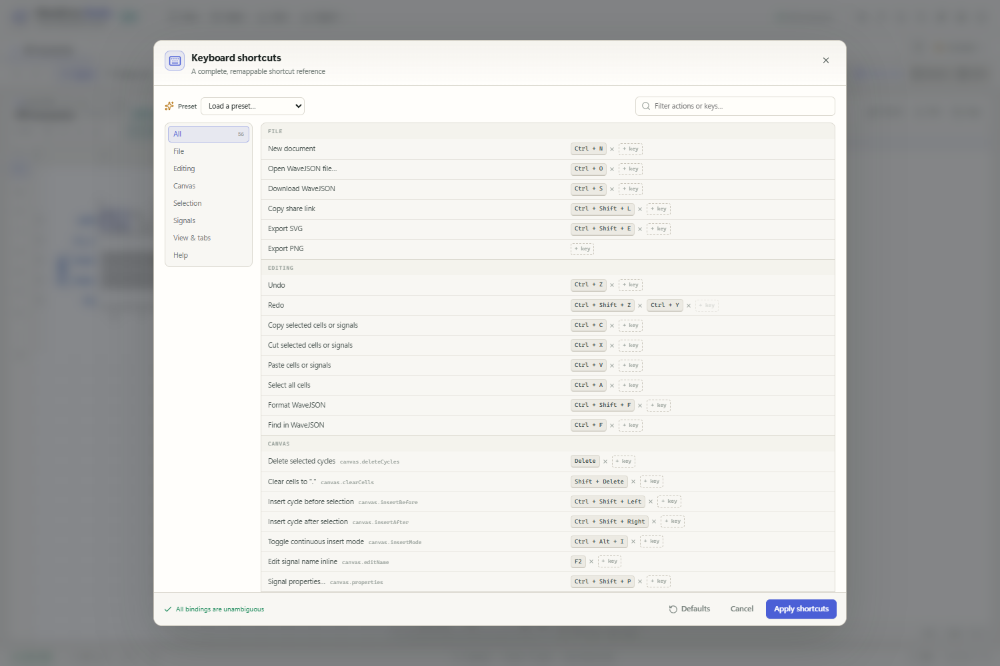

# Keyboard shortcut cheat sheet

WaveDrom Studio ships with a full, remappable keyboard workflow. Press <kbd>F1</kbd> (or use the keyboard icon in the header) to open the searchable shortcut manager inside the app. This document mirrors the default “WaveDrom Studio” preset and always describes the same 56 actions available in the configuration dialog.

## How shortcuts behave

- **Canvas shortcuts** (drawing, selection, cycle and signal commands) are active when the waveform panel has focus or a non-text UI element is focused. They deliberately do not interfere with typing in the WaveJSON editor.
- **Global shortcuts** (files, undo/redo, view mode, zoom, tabs and help) also work while the JSON editor is focused.
- Shortcut strings are ordered <kbd>Ctrl</kbd> → <kbd>Alt</kbd> → <kbd>Shift</kbd> → key. Up to **two bindings** can be assigned to one action.
- The shortcut manager validates conflicts live and refuses to save an ambiguous scheme. Use the built-in presets or Reset to defaults at any time.
- Browser-reserved combinations vary by browser. If a default such as <kbd>Ctrl</kbd> + <kbd>N</kbd>, <kbd>Ctrl</kbd> + <kbd>W</kbd> or <kbd>Ctrl</kbd> + <kbd>Tab</kbd> is intercepted by your browser, bind an alternative in the manager.

## Quick reference

| Action | Shortcut |
| --- | --- |
| Undo | <kbd>Ctrl + Z</kbd> |
| Redo | <kbd>Ctrl + Shift + Z</kbd> / <kbd>Ctrl + Y</kbd> |
| Delete selected cycles | <kbd>Delete</kbd> |
| Clear cells to "." | <kbd>Shift + Delete</kbd> |
| Insert cycle before selection | <kbd>Ctrl + Shift + Left</kbd> |
| Insert cycle after selection | <kbd>Ctrl + Shift + Right</kbd> |
| Toggle continuous insert mode | <kbd>Ctrl + Alt + I</kbd> |
| Edit signal name inline | <kbd>F2</kbd> |
| Group selected signals… | <kbd>Ctrl + G</kbd> |
| Ungroup selected signals | <kbd>Ctrl + Shift + G</kbd> |
| Add signal below selection + edit name | <kbd>Ctrl + Enter</kbd> |
| Fit clocks to longest lane | <kbd>Ctrl + Shift + 9</kbd> |
| Copy share link | <kbd>Ctrl + Shift + L</kbd> |
| Waveform only | <kbd>Ctrl + 1</kbd> |
| JSON editor only | <kbd>Ctrl + 2</kbd> |
| Split side by side | <kbd>Ctrl + 3</kbd> |
| Split top / bottom | <kbd>Ctrl + 4</kbd> |
| Reset zoom | <kbd>Ctrl + 0</kbd> |
| Shortcuts & quick help | <kbd>F1</kbd> |

## File

| Action | Default binding |
| --- | --- |
| New document | <kbd>Ctrl + N</kbd> |
| Open WaveJSON file… | <kbd>Ctrl + O</kbd> |
| Download WaveJSON | <kbd>Ctrl + S</kbd> |
| Copy share link | <kbd>Ctrl + Shift + L</kbd> |
| Export SVG | <kbd>Ctrl + Shift + E</kbd> |
| Export PNG | Unbound |

## Editing

| Action | Default binding |
| --- | --- |
| Undo | <kbd>Ctrl + Z</kbd> |
| Redo | <kbd>Ctrl + Shift + Z</kbd> / <kbd>Ctrl + Y</kbd> |
| Copy selected cells or signals | <kbd>Ctrl + C</kbd> |
| Cut selected cells or signals | <kbd>Ctrl + X</kbd> |
| Paste cells or signals | <kbd>Ctrl + V</kbd> |
| Select all cells | <kbd>Ctrl + A</kbd> |
| Format WaveJSON | <kbd>Ctrl + Shift + F</kbd> |
| Find in WaveJSON | <kbd>Ctrl + F</kbd> |

## Canvas

| Action | Default binding |
| --- | --- |
| Delete selected cycles | <kbd>Delete</kbd> |
| Clear cells to "." | <kbd>Shift + Delete</kbd> |
| Insert cycle before selection | <kbd>Ctrl + Shift + Left</kbd> |
| Insert cycle after selection | <kbd>Ctrl + Shift + Right</kbd> |
| Toggle continuous insert mode | <kbd>Ctrl + Alt + I</kbd> |
| Edit signal name inline | <kbd>F2</kbd> |
| Signal properties… | <kbd>Ctrl + Shift + P</kbd> |

## Selection

| Action | Default binding |
| --- | --- |
| Move selection left | <kbd>Left</kbd> |
| Move selection right | <kbd>Right</kbd> |
| Move selection up | <kbd>Up</kbd> |
| Move selection down | <kbd>Down</kbd> |
| Extend selection left | <kbd>Shift + Left</kbd> |
| Extend selection right | <kbd>Shift + Right</kbd> |
| Extend selection up | <kbd>Shift + Up</kbd> |
| Extend selection down | <kbd>Shift + Down</kbd> |
| Jump to row start | <kbd>Home</kbd> |
| Jump to row end | <kbd>End</kbd> |
| Select current row | <kbd>Ctrl + Space</kbd> |

## Signals

| Action | Default binding |
| --- | --- |
| Add signal below selection + edit name | <kbd>Ctrl + Enter</kbd> |
| Insert signal above | <kbd>Insert</kbd> |
| Insert signal below | <kbd>Ctrl + Insert</kbd> |
| Insert empty {} row | <kbd>Ctrl + Shift + Insert</kbd> |
| Duplicate selected signals | <kbd>Ctrl + D</kbd> |
| Delete selected signals | <kbd>Ctrl + Delete</kbd> |
| Move selected signals up | <kbd>Alt + Up</kbd> |
| Move selected signals down | <kbd>Alt + Down</kbd> |
| Group selected signals… | <kbd>Ctrl + G</kbd> |
| Ungroup selected signals | <kbd>Ctrl + Shift + G</kbd> |
| Fit clocks to longest lane | <kbd>Ctrl + Shift + 9</kbd> |

## View & tabs

| Action | Default binding |
| --- | --- |
| Waveform only | <kbd>Ctrl + 1</kbd> |
| JSON editor only | <kbd>Ctrl + 2</kbd> |
| Split side by side | <kbd>Ctrl + 3</kbd> |
| Split top / bottom | <kbd>Ctrl + 4</kbd> |
| Zoom in | <kbd>Ctrl + =</kbd> |
| Zoom out | <kbd>Ctrl + -</kbd> |
| Reset zoom | <kbd>Ctrl + 0</kbd> |
| Toggle light / dark theme | <kbd>Ctrl + Shift + T</kbd> |
| Diagram settings… | <kbd>Ctrl + Alt + G</kbd> |
| Close current tab | <kbd>Ctrl + W</kbd> |
| Next tab | <kbd>Ctrl + Tab</kbd> |
| Previous tab | <kbd>Ctrl + Shift + Tab</kbd> |

## Help

| Action | Default binding |
| --- | --- |
| Shortcuts & quick help | <kbd>F1</kbd> |

## Mouse and pointer actions

| Gesture | Result |
| --- | --- |
| Click a cell | Select it and make it the active paint cell |
| Drag across cells | Rectangular multi-cell selection |
| Drag into the empty area right of the lanes | Extend the selection; painting there extends `wave` strings |
| Drag a row grip in the left gutter | Reorder signals; the blue line shows the insertion point |
| Click a gutter row | Select the entire signal row |
| Shift-click / Ctrl-click gutter rows | Extend or toggle a row selection |
| Click a group bracket | Select every lane in the group |
| Double-click a signal name | Edit the name inline; <kbd>Enter</kbd> moves to the next name |
| Double-click a bus `data` label | Edit the label inline; <kbd>Tab</kbd> moves to the next data label |
| Middle-click a cell | Toggle continuous insert mode at that cell |
| Right-click a cell or group bracket | Open the editing context menu |
| Drag the divider between panes | Resize the waveform / JSON split |

## Drawable WaveDrom characters

| Character | Meaning | Character | Meaning |
| :---: | --- | :---: | --- |
| <kbd>0</kbd> | low level | <kbd>1</kbd> | high level |
| <kbd>x</kbd> | unknown | <kbd>z</kbd> | high impedance |
| <kbd>.</kbd> | repeat previous state | <kbd>=</kbd> | data bus |
| <kbd>2–9</kbd> | coloured data buses | <kbd>u</kbd> | bus up |
| <kbd>d</kbd> | bus down | <kbd>p</kbd> | positive clock |
| <kbd>n</kbd> | negative clock | <kbd>P</kbd> | positive edge marker |
| <kbd>N</kbd> | negative edge marker | <kbd>h</kbd> | high clock phase |
| <kbd>l</kbd> | low clock phase | <kbd>H</kbd> | high edge marker |
| <kbd>L</kbd> | low edge marker | <kbd>&#124;</kbd> | gap marker |
| <kbd>&lt;</kbd> | sub-cycle on | <kbd>&gt;</kbd> | sub-cycle off |

Characters are painted across every selected cell. With a single-cell selection the cursor advances one cell after painting. Upper-case <kbd>P</kbd>, <kbd>N</kbd>, <kbd>L</kbd>, <kbd>H</kbd> are distinct WaveDrom glyphs.

## Presets

All presets are edited as a draft in the shortcut manager; press **Apply shortcuts** to activate them.

### WaveDrom Studio

The complete keyboard workflow with all signal and cycle operations listed above.

### WaveDromGen classic

Desktop-editor muscle memory. Identical to the Studio preset except the theme toggle is
<kbd>Ctrl</kbd> + <kbd>Alt</kbd> + <kbd>Shift</kbd> + <kbd>D</kbd> and the share action is
<kbd>Ctrl</kbd> + <kbd>Alt</kbd> + <kbd>S</kbd>.

### Minimal

Leaves signal-specific shortcuts unbound and keeps navigation, selection, cycle deletion/clearing,
file actions, undo/redo, clipboard, format, split/zoom/view controls, tab closing and <kbd>F1</kbd>.

## Editing notes

- Inline label navigation wraps around the diagram. <kbd>Shift</kbd> + <kbd>Enter</kbd> / <kbd>Tab</kbd> reverses direction.
- A single-cell paint advances to the next cell; multi-cell rectangular selections remain selected after painting.
- Insert mode pushes existing cells right, one character per keystroke, and keeps the cursor moving. Exit with <kbd>Esc</kbd> or middle-click again.
- <kbd>Delete</kbd> removes the selected cells and shifts the rest of each selected lane left. <kbd>Shift</kbd> + <kbd>Delete</kbd> clears the selected cells to `.`.
- Use <kbd>Ctrl</kbd> + <kbd>G</kbd> to wrap the selected rows in a named group, and <kbd>Ctrl</kbd> + <kbd>Shift</kbd> + <kbd>G</kbd> to dissolve the selected group.

---

The defaults above are defined in [`src/lib/shortcuts.ts`](../src/lib/shortcuts.ts) and displayed by the in-app shortcut manager. Every binding can be changed without rebuilding the app; shortcut preferences are saved in local storage.
